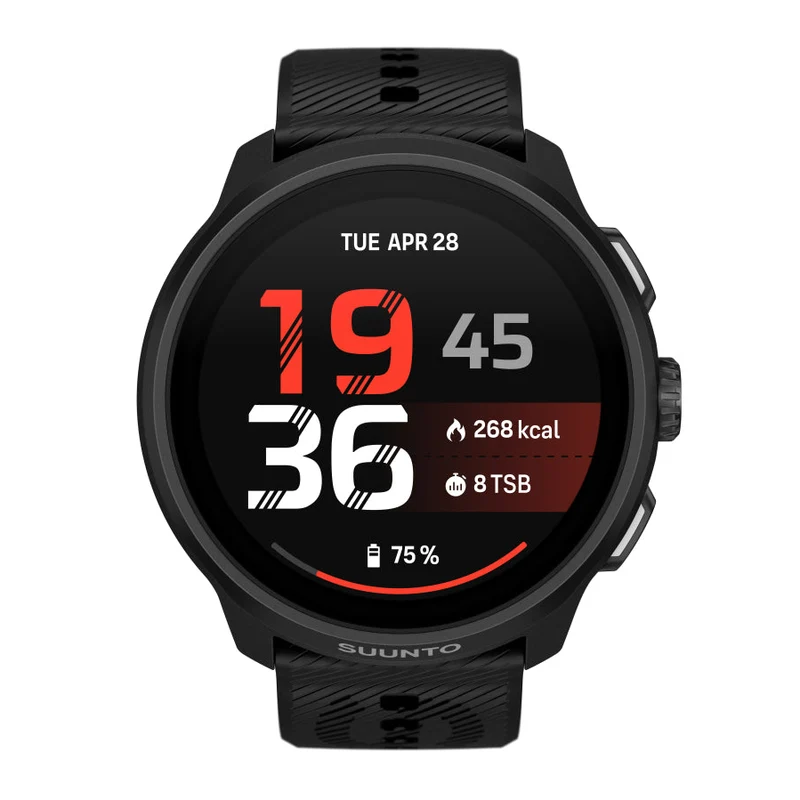

# Suunto-Inspired Garmin Watch Face

This Connect IQ watch face is inspired by the Suunto Run 2 design.



The reference image is included at [`resources/drawables/Suunto_Run2.png`](resources/drawables/Suunto_Run2.png).

## How to build

This project has multiple build/run options in VS Code:

- The project task **Connect IQ: Build fenix9pro51mm simulator** runs the custom build script. It builds for the Fenix 9 Pro 51 mm simulator, but does not launch the simulator.
- The Monkey C extension also provides build and run commands, including **Run Without Debugging**, which builds and launches the selected simulator target.

Before using the project task, create `.vscode/connectiq.local.env` in this project with the SDK root directory:

```text
CONNECTIQ_SDK_HOME=C:\path\to\ConnectIQ\SDK
```

Use the SDK directory that contains `bin\monkeybrains.jar`. This local env file contains a machine-specific path and is ignored by Git; do not commit it.

The custom build task also expects a Connect IQ signing key named `developer_key` in this project directory. Signing keys are ignored by Git and must be provided locally.

To run the custom task, open the repository's `garmin.code-workspace` in VS Code, then choose **Terminal: Run Task** and select **Connect IQ: Build fenix9pro51mm simulator**. If the simulator is not running yet, start it manually. After the build succeeds, click the simulator's **Restart** button to render the rebuilt watch face.
